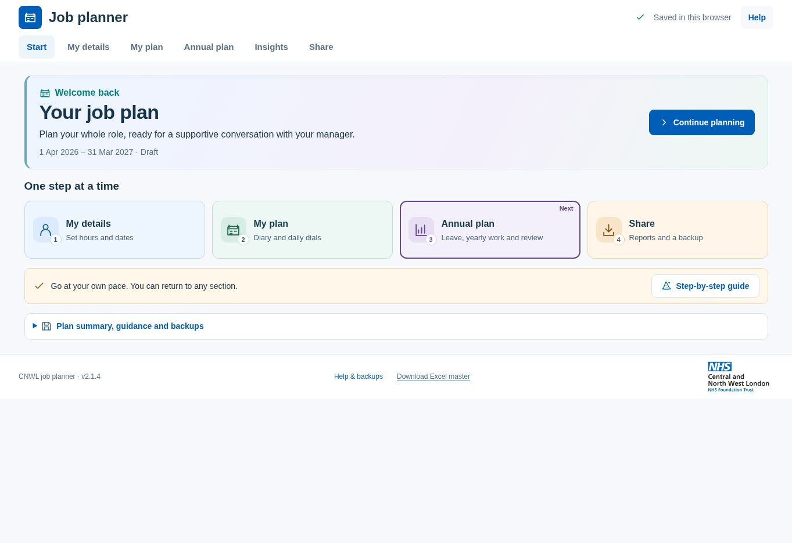
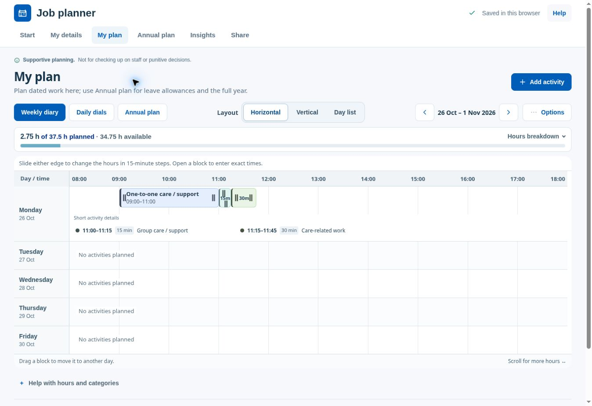

# Homepage colour and compact timetable in v2.1.4

The four homepage routes now have pale blue, green, lavender and warm gold backgrounds, with a labelled task icon and the existing step number. The welcome area has a subtle colour wash. The guide and backup areas have small supporting icons. The same short introduction, four routes and optional disclosure remain; no extra information panels were added.

The horizontal diary uses 64-pixel base rows instead of 98-pixel rows. Activity blocks and both time handles share the new lane spacing, so overlapping work still receives its own lane. Busy days grow to show their activities. Short-activity details can sit beside each other, rather than always consuming separate full-width rows. Full titles and exact times remain available through the activity controls.

The layout selector shares the main toolbar on wide screens, and the hours summary no longer has extra outer padding. The timetable can use more of the viewport. On a 1363 × 936 desktop check, all five weekdays were visible at once, including a day with three activities and two short-activity details. Smaller windows and busier plans may still need scrolling.

Short-activity handles are placed inside their respective endpoints, preventing the neighbouring 15-minute activity from intercepting a drag in the checked adjacent-activity case. Existing recurrence, overlap, paid-hours, undo and save protections are retained.

## Validation

- 39 regression checks pass, including all previous plan, save and export checks. New checks cover twelve overlapping activities staying within their allocated rows and overnight fragments preserving true endpoints and counting work once.
- All five executable inline scripts parse. The reconstructed deployment matches the complete packaged HTML.
- Desktop browser: all five weekdays visible with a populated Monday; mouse dragging and keyboard steps each saved a 15-minute reduction on the intended activity; Undo restored the original time. Every time handle in the checked adjacent 15-/30-minute sequence received pointer input at its centre.
- Laptop, 1280 × 720: the complete default homepage, four icons and footer fit; footer bottom measured 687 pixels.
- Phone, 390 × 740: homepage and both planner layouts had no horizontal page overflow. The horizontal timetable scrolls within its own region. All four homepage cards retained their icons and text.
- Screenshots use synthetic plan data. Shared preview hosting was restored to this checkout before the completed browser checks.

The browser storage key, backup schema, calculation formulas and embedded export libraries are unchanged. The source package contains no personal plan or QA harness.
