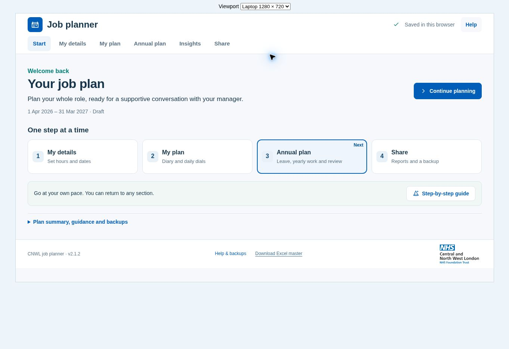
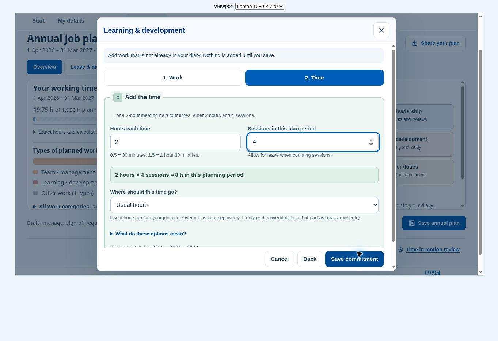

# Homepage and form clarity in v2.1.2

The homepage now presents one short introduction, a primary start/continue action and four numbered routes. The weekly summary, wider-role guidance, backup and restart controls sit behind an optional disclosure. The preparation checklist and wizard remain available. At 1280 × 720, the default homepage and footer fit without scrolling.

Annual planning now highlights six starting points drawn from the supplied annual-planning example:

- Supervision and reflection: given, received and appraisal.
- Meetings and leadership: professional forums, networks and reviews.
- Teaching and support: training, student support and visits.
- Learning and development: courses, reading and study.
- Projects and improvement: research, audit and co-production.
- Travel and other duties: travel, administration and recruitment.

These are optional prompts, not new reporting categories or required duties. Choosing one opens a form; it does not add work. Existing suggested activities retain their category mappings, and all eligible existing activities remain available. The annual-work picker lists these suggestions before day-to-day care activities. The activity picker used by the diary keeps its existing ordering.

## Forms

Numbered headings and softly tinted sections help distinguish groups of fields. Dark text, visible labels and white input fields provide contrast. Colour is an additional cue; section names and numbers carry the meaning. My details now explicitly heads the name/date area. Annual leave, discussion and sign-off have subtle background cues.

The annual-work form has two steps: Work and Time. Back and Next retain all input. Save appears on the Time step, after the duration can be reviewed. A live total explains hours multiplied by sessions, with examples for fractional hours and a reminder to allow for leave. Validation opens the relevant step without clearing other input. Sticky controls remain within the dialog.

## Verification

- `npm test`: 30 passing regression checks, including annual suggestion completeness, no implicit addition of work, the two-step form, fractional-hour previews, original planning calculations and PDF/XLSX generation.
- `npm run build`: five inline scripts parsed; reconstructed HTML matches the source checksum exactly.
- Laptop browser, 1280 × 720: default homepage and footer fit; optional summary and preparation checklist work; annual category shortcuts open correctly; given supervision maps to the existing Team and management work category; a 1.5-hour commitment repeated 10 times saves as 15 hours.
- Validation check: removing the work name on the first step, then saving from the second, reveals the missing field and retains the entered hours and sessions.
- Phone browser, 390 × 740: homepage, diary, annual planner and My details have no horizontal page overflow; the new annual form stays within the viewport with reachable actions.
- New section text/background palette checks have a minimum calculated contrast of 6.22:1. This is a focused palette check, not a complete accessibility certification.
- No application console errors were recorded in the completed browser checks. The shared preview briefly served another project; it was restarted against this checkout before final captures.

No application functions were removed. Core recurrence, capacity, annual saving and export logic are unchanged, as are embedded libraries, the browser storage key and schema. Screenshots use synthetic test data. Longer optional content still scrolls within its panel or dialog.

The release is supplied as a self-contained HTML file in a ZIP. It has been committed locally but not pushed or deployed.
