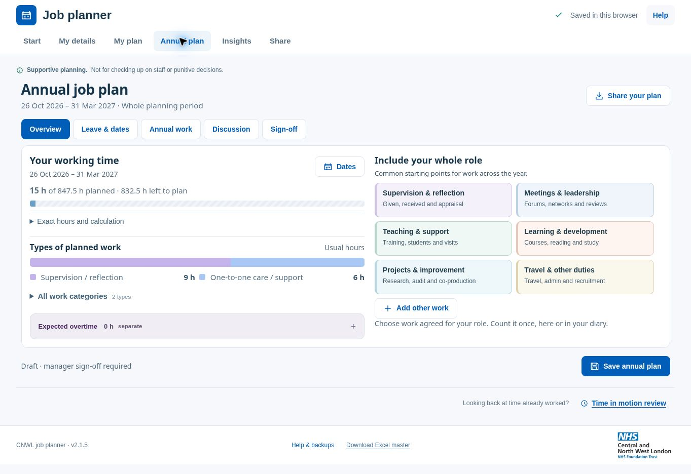

# Debug review — v2.1.5

Reviewed on 25 October 2026, starting from production commit `a0ac1c14ef3991276297fc847c7068cddebed11d` (v2.1.4). All fixtures and browser entries used synthetic data.

## Fixed

- **Cancelled exports could interrupt a newer form.** If PDF generation completed after closing the export window and opening another form, its completion could close that new form or replace it with the files-ready window. Late errors could also target the wrong form. Completion and failure now check that the original export window is still current. Cancellation during reference hashing also prevents a later reference write. Repeated submissions while preparation is running are ignored.
- **Start again discarded the selected diary layout.** Horizontal, Vertical and Day list preferences now survive starting a new plan. Retained weekend working hours also keep weekends visible. The completion message points to the current Start planning button.
- **Help referred to old controls.** Saving, continuing a plan, copying, saved activities and extending repeats now use the current navigation labels.
- **The reporting-reference error suggested an outdated browser even on an insecure connection.** The message now explains the secure-connection requirement and offers PDF-only as the alternative.

## Automated verification

`npm test` passes **61 checks**, up from 39. `npm run build` succeeds, checks the source hashes and parses all five inline scripts. The deployment HTML matches the edited source byte for byte. The four embedded library scripts remain unchanged.

Coverage includes saved-plan text escaping, backup schema compatibility, malformed backups, save failures and rollback, competing browser copies, recurrence exclusions, monthly/leap-year boundaries, fortnightly/four-weekly cycles, clock changes, overnight work, leave allowances, copy deduplication, diary sliders, daily dials, overtime, recorded-time limits and renewed sign-off after planned changes. The new export tests cover both successful and failed late completions after cancellation.

The real embedded PDF engine creates a readable five-page report. The Excel engine creates its two-sheet workbook. An additional inspection reopened generated PDF and XLSX files with independent readers and confirmed **6 dated hours + 9 undated hours = 15 planned hours**. The workbook archive is valid and excludes the synthetic staff name and private note.

## Browser checks

Checked in Chromium on the managed local preview:

- Invalid plan dates produce a clear error while preserving entries. A corrected period saves.
- An unfinished activity survives closing and reloading; completing it creates the intended weekly repeat.
- Annual commitment validation returns to the missing field. A 1.5-hour commitment repeated six times contributes nine hours.
- Leaving an edited annual discussion prompts to save; choosing to keep editing preserves its text.
- A downloaded JSON backup can be selected, reviewed and restored. Diary work, annual commitments and discussion survive restoration.
- Options opens; Horizontal, Vertical and Day list show the same scheduled work. A keyboard time-handle change saves 15 minutes less, changes only the intended occurrence and can be undone.
- Time in motion saves 90 recorded minutes without changing the 15-hour prospective annual plan.
- The checked annual view has no duplicate IDs, missing form labels or broken ARIA references.
- The homepage fits a 1280 × 720 laptop viewport. At 390 × 740, the homepage, horizontal and vertical diaries and annual overview have no horizontal page overflow. The horizontal timetable scrolls inside its own region. The activity dialog stays within the viewport, with its actions visible and its content scrollable.
- No application-origin console errors appeared in the inspected workflow logs. Browser-extension metadata errors were external to the application.

## Hosting and limits of this review

Cloudflare reports both `jplanner.space` and `www.jplanner.space` as active custom domains on `cnwl-job-planner`. Both DNS records point to this Pages project, whose production branch is GitHub `main`. No DNS or hosting reset was needed. The local-storage key and backup schema are unchanged; plans remain specific to each browser and hostname.

Public HTTP/HTTPS requests from this environment returned 403, so public-page rendering and HTTP-to-HTTPS behaviour could not be independently verified here. The managed preview uses HTTP, which does not expose the secure Web Crypto operation required for matching PDF/Excel report references. Its handled error was checked; the report engines and cancellation logic were verified separately. PDF-only preparation completed in the browser without an application error, but the browser tool did not capture its download event, so end-to-end PDF delivery is not claimed as verified. JSON backup download and restore were verified.

This is a broad regression and interaction review, not an exhaustive browser, assistive-technology or penetration-test certification. Native Safari/Firefox, a real touch device and the user's local cache were not available for this pass. No personal plans, filled staff reports or temporary test harness are included in the release.
