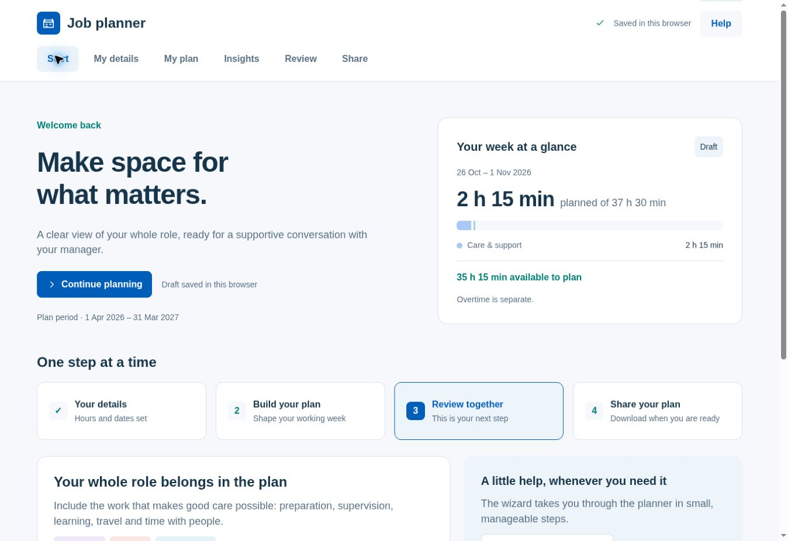

# Figma refresh — v2.1.0

Design: https://www.figma.com/design/TlWUVHmrtFZUdGddibbiTQ

The homepage, weekly diary, daily dials, Share screen and mobile navigation now follow the approved designs. Counts, hours and dates come from the current plan rather than the sample content shown in Figma. Existing embedded icons, logos, category colours and production fonts are reused; no external assets or network requests are added.

## Behaviour

- Start shows the selected week's actual balance and links to details, planning, review and sharing. The wizard, optional preparation checklist and backup/restore controls remain available.
- The desktop planner opens in weekly cards. Every activity is shown, including overnight carry-over context; weekend work has a reveal control. Day and timeline layouts, other date ranges, filters, copying, breaks and leave remain under Options.
- Daily dials offer 15-minute adjustments and exact-minute entry. They use the existing capacity validation, repeat handling, saved-plan history and agreement invalidation. Six common categories are initially visible; active additional categories remain visible, and all other categories are available in a disclosure.
- Share distinguishes the PDF report, coded Excel summary and editable JSON backup. Existing report options, sign-off and master-workbook guidance remain available.
- At phone widths, Start and My plan stay visible, with My details, Insights, Review and Share under More. Cards stack; the weekly grid scrolls within its own labelled region.

The `cnwl-job-planner-v1` storage key and schema 1 are unchanged. Existing calculation, recurrence, validation, PDF, Excel and backup engines are retained. Embedded libraries and the Content Security Policy are byte-for-byte unchanged from v2.0.14. Plans are still stored locally in the browser.

## Verification

`npm test` validates the source checksums, release footer and all five inline scripts, then runs 17 checks in `tests/planner-regression.cjs`. These cover saved-data compatibility, text escaping, dial edits, agreement between diary/report totals, grouped homepage totals, paid-time limits, breaks, overtime, repeat instances, every work category, view switching, longer activity lists, overnight work, backup round-tripping, Share actions, and exclusion of names/private notes from Excel. The embedded export engines also generate a readable five-page PDF and an XLSX archive.

Browser checks used synthetic data in a local preview: saving details, reloading saved work, daily 15-minute adjustments, exact-minute entry, Undo availability, the populated weekly diary, the Share options dialog, and mobile Start/More/Share navigation. The 390px mobile preview had no horizontal body overflow. Desktop and mobile screenshots were inspected. No application console errors were observed.

The browser PDF action closed successfully, but the automation did not capture its download event. PDF generation is verified by the embedded-engine test; the final browser download and opening the Excel file in desktop Excel remain release smoke checks. This is not an exhaustive accessibility or cross-browser audit.

## Source review

Build the repository to inspect `dist/index.html`. Presentation changes are in the `figma-refresh` style block and the `renderHome`, `renderWeekDiary`, `renderLiveDials`, `dayDialCard`, `renderFinish`, `renderV2Navigation`, `calmPlanHeading`, `calmPeriodBar`, `calmHoursSummary` and `figma*` helpers. Existing actions are reused, with a small added handler for 15-minute steps and a full-circle pointer calculation for the live dials.

The output is a single HTML file. Publishing this branch requires merging it into the production branch and checking the resulting Cloudflare Pages deployment. This implementation has not changed production.
