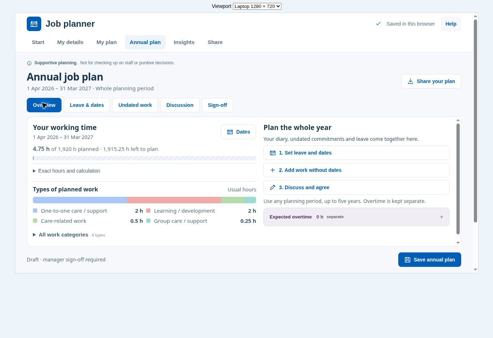

# Usability fixes in v2.1.1

The Figma refresh called `calmOption()` from the Options menu but omitted the helper itself. Opening Options raised a `ReferenceError`. This release restores the helper and checks both the weekly diary and daily dials routes.

Annual planning was still available through the former Review screen. It now has an explicit **Annual plan** link in the main navigation, planning view switch, Options menu and homepage. The all-dates diary remains available separately in Options.

## Changes

- Annual planning has five sections: Overview, Leave & dates, Undated work, Discussion and Sign-off. All original form fields remain in one mounted form. Switching sections retains unsaved input; validation opens the section containing the problem field.
- The activity form uses Activity, Time and Repeat & notes sections, retaining the existing draft, repeat and save behaviour. Common activity suggestions remain available in a disclosure. Validation reveals fields in hidden sections.
- Generic category activity titles such as `care related work` display as **Care-related work**. Stored titles and custom activity names are preserved.
- Smaller header spacing, summary cards and dials put more useful information on screen. The Share page shows real plan totals instead of the oversized decorative report cover.
- Dialogs stay within the viewport, with fixed headings and sticky action bars. Longer content scrolls inside the window. Annual sections are bounded on desktop; phone layouts use normal vertical page flow and a sticky Save button.
- Help, unsaved-change prompts and report guidance use the visible Annual plan name. PDF-only guidance no longer says to prepare both files.

The local storage key and schema remain unchanged. Recurrence, capacity and work-total calculations are unchanged. Embedded assets and export libraries are preserved. No backend, account or new network dependency was added.

## Verification

`npm test` passes 26 regression checks, including the repaired Options actions, annual navigation and field preservation, activity form variants, title escaping and capitalisation, repeat handling, overtime separation, backup compatibility, PDF generation and XLSX generation. The five inline JavaScript blocks parse successfully. `npm run build` restores exactly the same HTML bytes as the editing copy.

Browser checks used synthetic data in a local preview:

| Viewport | Checks |
| --- | --- |
| Laptop, 1280 × 720 | Main pages; Options opens and fits; all-dates selection; weekly pattern builder; activity sections, hidden-field validation and save; annual leave and discussion save; section changes retain edits; undated work; report options. |
| Phone, 390 × 740 | Main pages, Help, work categories and time-in-motion review have no horizontal page overflow; More navigation works; Options, activity, undated-work and export dialogs stay within the viewport; annual commitment saves; wizard fits. |
| Tablet, 768 × 768 | Diary and annual planning have no horizontal page overflow. |

An activity titled `care related work` was saved across form sections and appeared in the correct dial as 30 minutes. A two-session annual commitment saved as two hours. Errors in hidden annual/activity sections revealed the relevant fields without clearing other input. No application errors were recorded in the completed browser checks; unrelated browser-extension messages were excluded.

Long reports, advanced options and full-year diary lists still require scrolling. This review does not claim every possible data set fits on one screen. Mobile keyboards, screen-reader announcements, production hosting and the final operating-system download flow were not independently tested. Export engines were exercised directly with a readable five-page PDF and an XLSX archive.

## Delivery

The release is a self-contained v2.1.1 HTML file, also provided in a ZIP. It has not been pushed or deployed. A local downloaded HTML file and the production domain have separate browser storage; use the existing JSON backup/restore workflow to move a plan between them.
